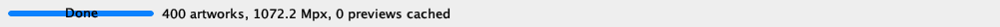

# M-01: completed progress bar readability

The submitter reported that `Done` was difficult to read over the full progress
bar. This was reproduced with 400 artworks.

## Reproduction and evidence

The diagnostic [CaptureProgress.java](CaptureProgress.java) calls the unmodified
`Gallery.main` with 400 artworks, waits for progress 400/400 and `Done`, and waits
for the status label to report 400 artworks without the scanning marker. It then
saves Swing component rendering with `printAll` on the EDT. It does not change the
look and feel, component sizes, text or progress settings.

From the repository root, with `JAVA_HOME` set to your installed JDK:

```sh
"$JAVA_HOME/bin/javac" -d work/progress-capture suite/lib/Gallery.java suite/lib/GalleryTestSupport.java evidence/manual-2026-11-08-startup/CaptureProgress.java
"$JAVA_HOME/bin/java" -cp work/progress-capture CaptureProgress evidence/manual-2026-11-08-startup > evidence/manual-2026-11-08-startup/capture.log 2>&1
```

- [Capture log](capture.log): exact timestamp, environment, UI delegate, component dimensions and final values.
- [Completed window content](completed-window-content.png).
- [Completed status panel](completed-status-panel.png).
- [Progress component](completed-progress.png).

Visual inspection of the saved rendering confirms black `Done` centered over a
thin blue horizontal bar that crosses the letters. No literal `100%` text is
present: the value is 400/400, and the displayed string is `Done`.



These images are component renderings at logical dimensions, not OS screenshots.
The desktop uses a 2x screen transform. Native screen compositing and physical
pixel appearance have not been independently captured. Attempts to access the
Java window through computer-use tools returned `Invalid app`.

The final capture was made with OpenJDK 21.0.13, macOS 26.7.2 and
`com.apple.laf.AquaLookAndFeel` / `com.apple.laf.AquaProgressBarUI`. The progress
component is 146 x 20 logical units. See the log for completion time and colors.

## Requirement and assessment

The assignment PDF, page 1, **Expected behaviour → Scanning**, states:

> The progress bar follows the scan and reads "Done" when complete.

The final value and string satisfy this functional requirement. Keeping a full
bar is permitted; hiding or resetting it is not required. The intersecting blue
bar and text are reported separately as a visual readability issue in
[BUG-06](../../reports/BUG-06-progress-text-readability.md), severity Minor.
The PDF does not specify a contrast threshold or exact visual design.

Gallery.java remains unchanged, SHA-256:
`06c13fe21b278bcf8192b35f45041aef6698ed1d4fa64a0ab9a6c869cff1f3bb`.

M-01 is **FAIL** due to BUG-06. The completion-state rendering was reproduced;
other startup assertions have not all been verified in this execution.
